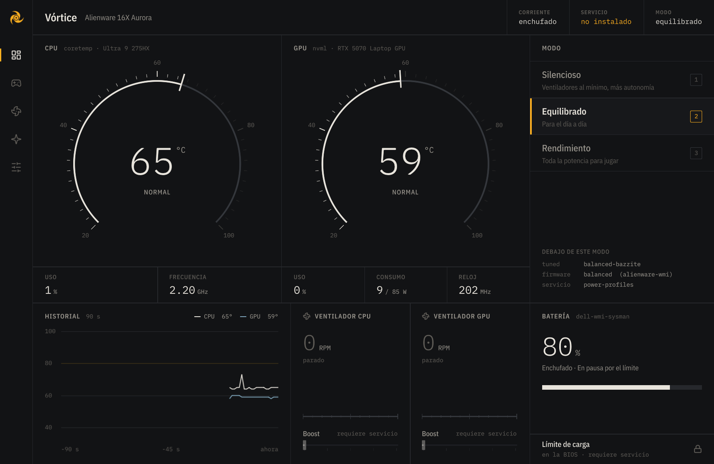

<p align="center">
  
</p>

<h1 align="center">Vórtice</h1>

<p align="center">
  <b>El centro de control para portátiles gaming en Linux.</b><br>
  Temperaturas, ventiladores, modos de rendimiento y batería en una sola app,<br>
  diseñada como un instrumento de medición y con un consumo mínimo.
</p>

<p align="center">
  
</p>

> **Estado: beta temprana.** Probado a fondo en un Alienware 16X Aurora con Bazzite.
> Si tienes otro portátil, tu informe es lo que más ayuda al proyecto (ver *Contribuir*).

## Por qué Vórtice

Los fabricantes no publican sus apps de control para Linux, y la comunidad ha
respondido con decenas de herramientas sueltas: una por marca, a veces una por
modelo, muchas abandonadas. Vórtice quiere ser **una sola app para todas las marcas**.

En lugar de escribir un driver por modelo, Vórtice usa las **interfaces estándar
del kernel** (`hwmon`, `platform-profile`, `firmware-attributes`, `power_supply`)
y servicios estándar (`power-profiles-daemon` / `tuned-ppd`, NVML). Cada vez que el
kernel añade soporte para un portátil, Vórtice lo aprovecha sin cambios.

## Funciones

| | |
|---|---|
| **Temperaturas** | CPU (Intel / AMD) y gráfica, con historial de 90 s |
| **Gráficas** | NVIDIA (NVML), AMD (`amdgpu`) e Intel (`i915` / `xe`). En portátiles híbridos no despierta la gráfica dedicada si está en reposo |
| **Modos de rendimiento** | Silencioso · Equilibrado · Rendimiento, vía D-Bus. Respeta a `tuned` y a KDE/GNOME en lugar de pelearse con ellos |
| **Ventiladores** | RPM en vivo y *boost* manual (Alienware / Dell G por ahora) |
| **Batería** | Modos y umbrales de carga guardados en el firmware (Dell, ThinkPad, ASUS, Framework y otros con la interfaz estándar) |
| **Ligera** | Indicadores dibujados con shaders en la GPU: ~3 % de un núcleo con la ventana abierta, aún menos minimizada |

## Compatibilidad

| Función | Dónde funciona hoy |
|---|---|
| Temperatura de CPU | Cualquier Intel o AMD |
| Gráfica | NVIDIA, AMD, Intel |
| Leer ventiladores | La mayoría de portátiles con driver en el kernel |
| *Boost* de ventiladores | Alienware / Dell G (`alienware-wmi`). ASUS, HP y ThinkPad: en desarrollo |
| Límite de batería | Dell / Alienware (`dell-wmi-sysman`) e interfaz estándar `charge_control_*` |
| Modos de rendimiento | Distros con `power-profiles-daemon` o `tuned-ppd` |
| Distros | Con systemd. Probado en Bazzite (Fedora) |

## Instalación (desarrollo)

```sh
git clone https://github.com/bernaljeanp/vortice.git
cd vortice
python3 -m venv .venv
.venv/bin/pip install -r requirements.txt
./vortice.sh
```

### Servicio para ventiladores y batería (opcional)

Cambiar el *boost* o el límite de carga requiere permisos de administrador. Vórtice
usa un servicio mínimo que **solo** expone esas operaciones, valida cada valor y solo
acepta a administradores del sistema (grupo `wheel`, `sudo` o `admin`):

```sh
pkexec "$PWD/helper/install.sh"          # instalar
pkexec "$PWD/helper/install.sh" --uninstall
```

El código privilegiado se copia a `/usr/local/libexec/vortice/` (propiedad de root)
y corre aislado por systemd: sin red, sin acceso a `/home` y con el sistema en solo
lectura salvo `/sys`. Al detenerse, devuelve los ventiladores a automático.

Requiere PyGObject del sistema (`python3-gobject` en Fedora, `python3-gi` en
Debian/Ubuntu, `python-gobject` en Arch).

## Desarrollo

```sh
.venv/bin/python -m unittest discover -s tests -v   # pruebas
tools/measure.sh 20                                  # consumo de CPU de la app
VORTICE_SHOT=captura.png ./vortice.sh                # captura automática

# Simular hardware ausente para probar los avisos:
VORTICE_SIMULATE="no-gpu,gpu-asleep,no-ppd,tlp,no-fans,no-battery" ./vortice.sh

# Recompilar shaders (requiere requirements-dev.txt):
tools/build_shaders.sh
```

Estructura:

```
vortice/hardware.py   detección y lectura de sensores (interfaces estándar)
vortice/gpu.py        NVIDIA / AMD / Intel
vortice/app.py        puente Python ↔ QML
vortice/qml/          interfaz (Qt Quick)
vortice/shaders/      indicadores en GLSL
helper/               servicio privilegiado + instalador
tests/                pruebas con sysfs simulado
```

## Contribuir

Lo más valioso ahora mismo: **probar Vórtice en tu portátil** y abrir un *issue* con
tu modelo, distro y qué funciona o no. Ejecuta `.venv/bin/python -m vortice.hardware`
y adjunta la salida.

## Licencia

[GPL-3.0](LICENSE). Iconos de interfaz derivados de [Lucide](https://lucide.dev) (ISC).
Fuentes IBM Plex Sans Condensed e IBM Plex Mono (SIL Open Font License).
