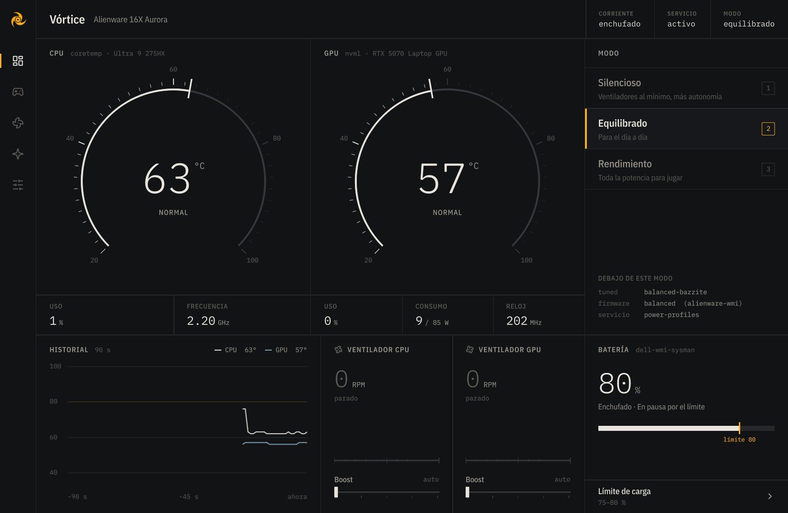
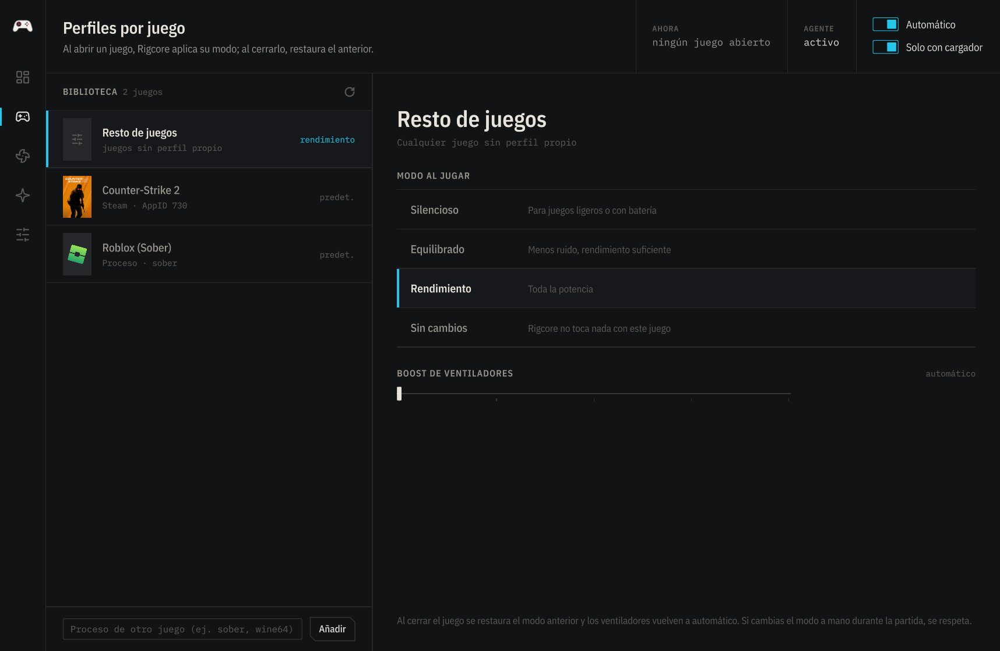
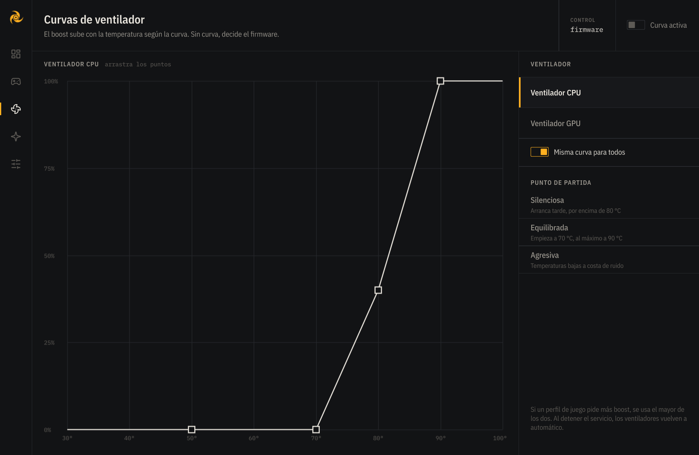
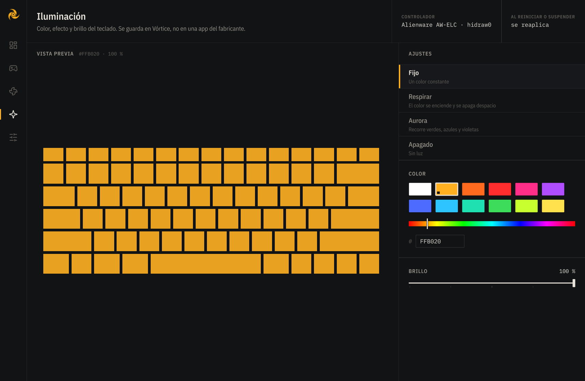
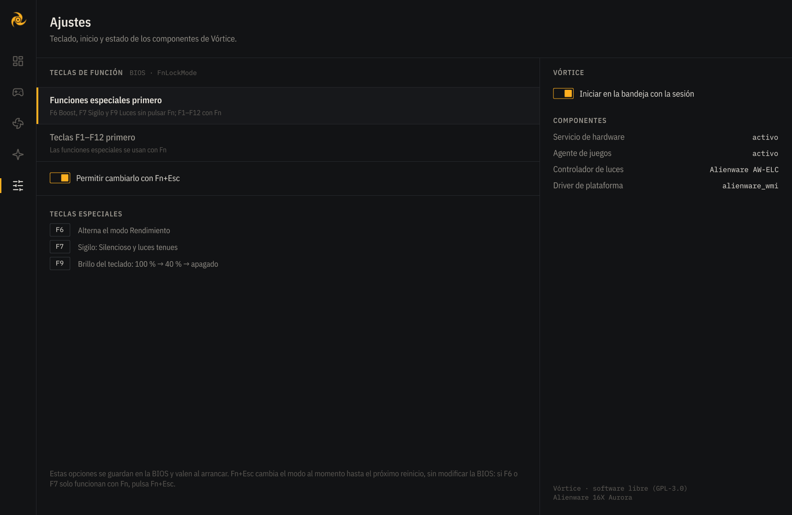

<p align="center">
  
</p>

<h1 align="center">Vórtice</h1>

<p align="center">
  <b>El centro de control para portátiles gaming en Linux.</b><br>
  Temperaturas, ventiladores, modos de rendimiento, batería, luces del teclado y perfiles por juego<br>
  en una sola app, diseñada como un instrumento de medición y con un consumo mínimo.
</p>

<p align="center">
  
</p>

> **Estado: beta.** Probado a fondo en un Alienware 16X Aurora con Bazzite (KDE Plasma, Wayland).
> El soporte de otras marcas sigue la documentación del kernel y de los proyectos de cada marca y
> está probado con sysfs simulados, pero no en esos equipos: tu informe es lo que más ayuda (ver *Contribuir*).

**Seguridad en el control manual:** en los ventiladores con velocidad manual (ThinkPad, Dell, HP
Victus S), Vórtice fuerza el máximo a partir de 90 °C, devuelve el control al firmware con el valor 0
y siempre al detener el servicio.

## Por qué Vórtice

Los fabricantes no publican sus apps de control para Linux, y la comunidad ha
respondido con decenas de herramientas sueltas: una por marca, a veces una por
modelo, muchas abandonadas. Vórtice quiere ser **una sola app para todas las marcas**.

En lugar de escribir un driver por modelo, Vórtice usa las **interfaces estándar
del kernel** (`hwmon`, `platform-profile`, `firmware-attributes`, `power_supply`,
`hidraw`) y servicios estándar (`power-profiles-daemon` / `tuned-ppd`, NVML). Cada vez
que el kernel añade soporte para un portátil, Vórtice lo aprovecha.

## Funciones

| | |
|---|---|
| **Panel** | Temperatura de CPU y GPU con indicadores de escala, uso, frecuencia, consumo, historial de 90 s, ventiladores y batería |
| **Modos de rendimiento** | Silencioso · Equilibrado · Rendimiento por D-Bus; respeta a `tuned` y al escritorio. Teclas 1, 2, 3 |
| **Perfiles por juego** | Modo y boost por juego (Steam con sus carátulas, o cualquier proceso). Un agente ligero los aplica al abrir el juego y restaura todo al cerrarlo |
| **Curvas de ventilador** | Boost según la temperatura, con editor de puntos, histéresis y presets; las aplica el servicio aunque la app esté cerrada |
| **Iluminación** | Color fijo, respirar, aurora y brillo del teclado (Alienware AW-ELC); se reaplica al arrancar y al volver de la suspensión |
| **Batería** | Modos y umbrales de carga guardados en el firmware (Dell/Alienware y la interfaz estándar `charge_control_*`) |
| **Bandeja y teclas** | Icono con el color del panel, menú rápido y teclas especiales (en Alienware: F6 Boost, F7 Sigilo, F9 Luces) |
| **Gráficas** | NVIDIA (NVML), AMD (`amdgpu`) e Intel (`i915`/`xe`). En portátiles híbridos no despierta la gráfica dedicada en reposo |
| **Ligera** | ~3 % de un núcleo con la ventana abierta; en la bandeja ~0,25 %. La ventana corre en su propio proceso y devuelve toda su memoria al cerrarse |

<table>
  <tr>
    <td></td>
    <td></td>
  </tr>
  <tr>
    <td></td>
    <td></td>
  </tr>
</table>

## Compatibilidad

| Función | Dónde funciona hoy |
|---|---|
| Temperatura de CPU | Cualquier Intel o AMD |
| Gráfica | NVIDIA, AMD, Intel |
| Leer ventiladores | La mayoría de portátiles con driver en el kernel |
| Control de ventiladores y curvas | **Alienware / Dell G** (boost sobre el firmware) · **ThinkPad** (manual, con `thinkpad_acpi fan_control=1`) · **ASUS** (automático/máximo y curva guardada en el firmware) · **HP Omen/Victus** (automático/máximo; manual en Victus S) · **MSI** con msi-ec (Cooler Boost) · **Acer Predator/Nitro** con Linuwu-Sense · otros Dell y sobremesas (`pwmN` estándar) |
| Límite de batería | Dell / Alienware (`dell-wmi-sysman`), interfaz estándar `charge_control_*` (ThinkPad, ASUS, Framework, MSI…), **Lenovo** (modo conservación) y **Acer** (límite al 80 %) |
| Luces del teclado | **Alienware / Dell G** (AW-ELC: color, respirar, aurora) · **ASUS TUF/ROG** (`kbd_rgb_mode`: color, respirar, ciclo) · **Acer Predator/Nitro** con Linuwu-Sense (4 zonas: color, respirar, onda) · teclados **RGB estándar** (LED multicolor: Tuxedo/Clevo, System76…) · **brillo** de cualquier teclado retroiluminado |
| Teclas especiales | Alienware 16X Aurora (otros modelos: aporta tus códigos con `tools/scan_keys.py`) |
| Modos de rendimiento | Distros con `power-profiles-daemon` o `tuned-ppd` (si usas TLP, Vórtice lo indica) |
| Distros | Con systemd. Probado en Bazzite (Fedora) |

## Instalación (desarrollo)

```sh
git clone https://github.com/bernaljeanp/vortice.git
cd vortice
python3 -m venv .venv
.venv/bin/pip install -r requirements.txt
./vortice.sh               # ventana
./vortice.sh --bandeja     # en la bandeja (se puede activar al iniciar sesión desde Ajustes)
```

### Servicio para ventiladores, batería y luces

Cambiar el boost, las curvas, el límite de carga, la iluminación persistente o el
bloqueo de Fn requiere permisos de administrador. Vórtice usa un servicio mínimo que
**solo** expone esas operaciones, valida cada valor y solo acepta a administradores
del sistema (grupo `wheel`, `sudo` o `admin`):

```sh
pkexec "$PWD/helper/install.sh"              # instalar
pkexec "$PWD/helper/install.sh" --uninstall  # desinstalar
```

El código privilegiado se copia a `/usr/local/libexec/vortice/` (propiedad de root)
y corre aislado por systemd: sin red, sin acceso a `/home`, con el sistema en solo
lectura salvo `/sys`, y acceso solo a dispositivos `hidraw`. Al detenerse, devuelve los
ventiladores a automático. De la BIOS solo puede cambiar las opciones de una lista
blanca (bloqueo de Fn). En equipos Alienware instala además una regla `hwdb`, limitada
al modelo, que reasigna las teclas especiales que el escritorio no puede usar.

Requiere PyGObject del sistema (`python3-gobject` en Fedora, `python3-gi` en
Debian/Ubuntu, `python-gobject` en Arch).

## Desarrollo

```sh
.venv/bin/python -m unittest discover -s tests -v   # pruebas
tools/measure.sh 20                                  # consumo de CPU de la ventana
VORTICE_SHOT=captura.png ./vortice.sh --ventana      # captura automática
./vortice.sh --ventana --pagina 2                    # abrir en una página

# Simular hardware ausente para probar los avisos:
VORTICE_SIMULATE="no-gpu,gpu-asleep,no-ppd,tlp,no-fans,no-battery" ./vortice.sh --ventana

tools/build_shaders.sh                          # recompilar shaders (requirements-dev.txt)
pkexec /usr/bin/python3 -I tools/scan_keys.py   # códigos de las teclas especiales
```

Estructura:

```
vortice/hardware.py   detección y lectura de sensores (interfaces estándar)
vortice/gpu.py        NVIDIA / AMD / Intel
vortice/lights.py     controlador de luces AW-ELC
vortice/fans.py       control de ventiladores por marca (boost, pwm, auto/máximo...)
vortice/fancurve.py   curvas de ventilador
vortice/agent.py      agente de perfiles por juego (servicio de usuario)
vortice/games.py      biblioteca de juegos y configuración
vortice/tray.py       bandeja, instancia única, teclas
vortice/app.py        puente Python ↔ QML
vortice/qml/          interfaz (Qt Quick)
vortice/shaders/      indicadores en GLSL
helper/               servicio privilegiado, regla de teclas e instalador
tests/                pruebas con sysfs simulado
```

## Contribuir

Lo más valioso ahora mismo: **probar Vórtice en tu portátil** y abrir un *issue* con
tu modelo, distro y qué funciona o no. Ejecuta `.venv/bin/python -m vortice.hardware`
y adjunta la salida.

## Licencia

[GPL-3.0](LICENSE). Iconos de interfaz derivados de [Lucide](https://lucide.dev) (ISC).
Fuentes IBM Plex Sans Condensed e IBM Plex Mono (SIL Open Font License).
Protocolo de luces AW-ELC documentado por [alienfx-tools](https://github.com/T-Troll/alienfx-tools) (MIT).
Interfaces de otras marcas estudiadas en la documentación del kernel y en
[msi-ec](https://github.com/BeardOverflow/msi-ec), [Linuwu-Sense](https://github.com/0x7375646F/Linuwu-Sense),
[LenovoLegionLinux](https://github.com/johnfanv2/LenovoLegionLinux) y [asusctl](https://gitlab.com/asus-linux/asusctl)
(sin copiar su código).
Las carátulas de juegos que aparecen en las capturas pertenecen a sus respectivos dueños.
