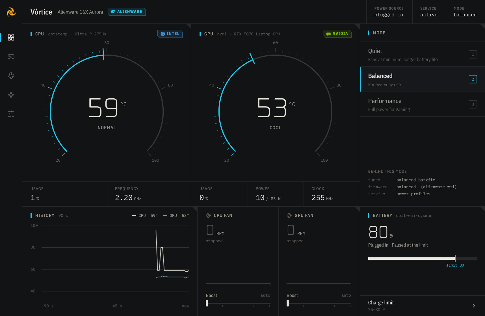
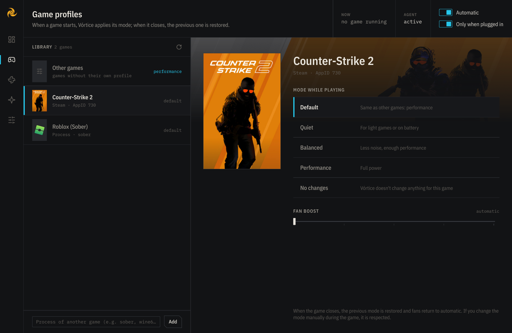
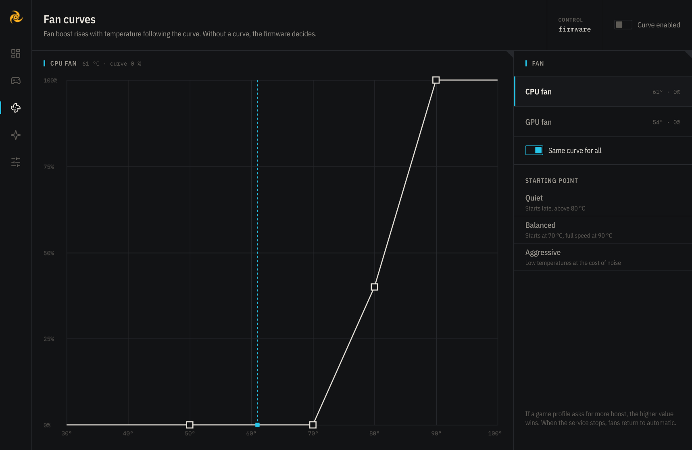
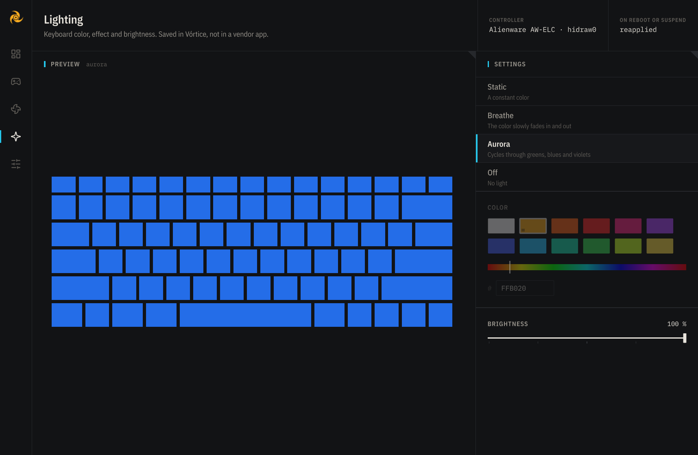
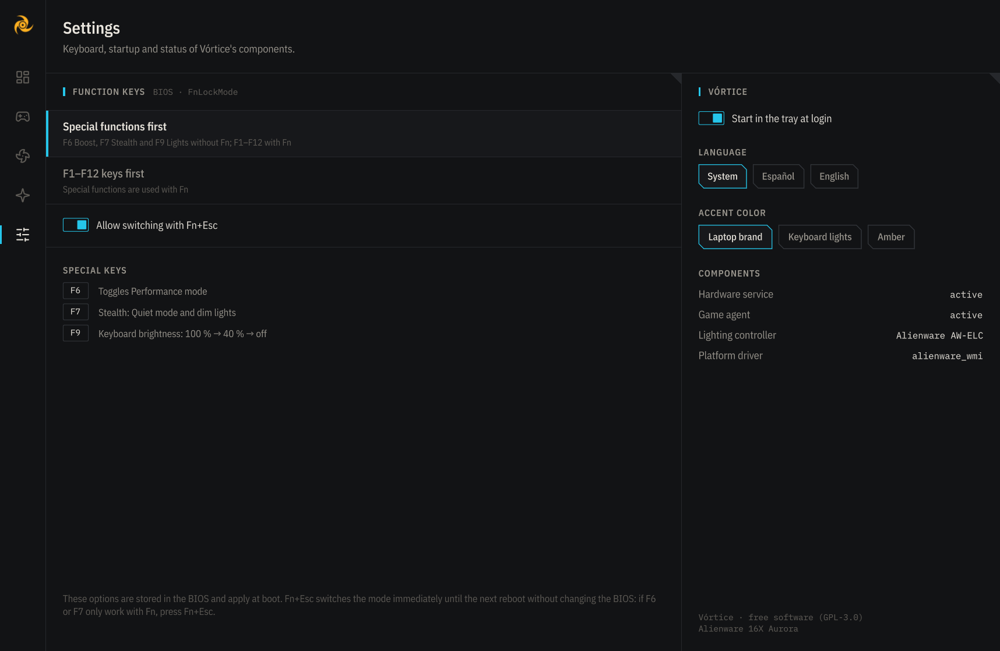

<p align="center">
  
</p>

<h1 align="center">Vórtice</h1>

<p align="center"><b>English</b> · <a href="README.es.md">Español</a></p>

<p align="center">
  <b>The control center for gaming laptops on Linux.</b><br>
  Temperatures, fans, performance modes, battery, keyboard lighting and game profiles<br>
  in a single app, designed like a measuring instrument and with minimal resource use.
</p>

<p align="center">
  
</p>

> **Status: beta.** Thoroughly tested on an Alienware 16X Aurora running Bazzite (KDE Plasma, Wayland).
> Support for other brands follows the kernel documentation and each brand's community projects and
> is tested against simulated sysfs trees, not on that hardware: your report helps the most (see *Contributing*).

**Safety with manual fan control:** on fans with manual speed control (ThinkPad, Dell, HP Victus S),
Vórtice forces maximum speed from 90 °C, hands control back to the firmware for a value of 0, and always
when the service stops.

## Why Vórtice

Laptop vendors don't ship their control apps for Linux, and the community has
answered with dozens of separate tools: one per brand, sometimes one per model,
many of them abandoned. Vórtice aims to be **one app for every brand**.

Instead of writing a driver per model, Vórtice uses the **standard kernel interfaces**
(`hwmon`, `platform-profile`, `firmware-attributes`, `power_supply`, `hidraw`) and standard
services (`power-profiles-daemon` / `tuned-ppd`, NVML). Every time the kernel adds support for
a laptop, Vórtice benefits from it.

## Features

| | |
|---|---|
| **Dashboard** | CPU and GPU temperature on scale gauges, usage, frequency, power, 90 s history, fans and battery |
| **Performance modes** | Quiet · Balanced · Performance over D-Bus; plays nicely with `tuned` and the desktop. Keys 1, 2, 3 |
| **Game profiles** | Mode and fan boost per game (Steam with cover art, or any process). A lightweight agent applies them when a game starts and restores everything when it closes |
| **Fan curves** | Boost driven by temperature, with a point editor, hysteresis and presets; applied by the service even when the app is closed |
| **Lighting** | Keyboard color, breathing, aurora and brightness; reapplied at boot and after resume |
| **Battery** | Charging modes and thresholds stored in the firmware |
| **Tray and keys** | Icon matching the panel color, quick menu and special keys (on Alienware: F6 Boost, F7 Stealth, F9 Lights) |
| **GPUs** | NVIDIA (NVML), AMD (`amdgpu`) and Intel (`i915`/`xe`). On hybrid laptops it never wakes a sleeping discrete GPU |
| **Lightweight** | ~3 % of one core with the window open; ~0.25 % in the tray. The window runs in its own process and returns all its memory when closed |
| **Languages** | English and Spanish, following the system language; selectable in *Settings* |
| **Brand identity** | The accent color follows your laptop brand (Alienware cyan, ROG/MSI red…), your keyboard lights, or amber; vendor badges drawn in-house (no official logos) |

<table>
  <tr>
    <td></td>
    <td></td>
  </tr>
  <tr>
    <td></td>
    <td></td>
  </tr>
</table>

## Compatibility

| Feature | Where it works today |
|---|---|
| CPU temperature | Any Intel or AMD CPU |
| GPU | NVIDIA, AMD, Intel |
| Fan readings | Most laptops with a kernel driver; MSI with msi-ec (in %) |
| Fan control and curves | **Alienware / Dell G** (boost over the firmware curve) · **ThinkPad** (manual, with `thinkpad_acpi fan_control=1`) · **ASUS** (auto/max and a curve stored in the firmware) · **HP Omen/Victus** (auto/max; manual on Victus S) · **MSI** with msi-ec (Cooler Boost) · **Acer Predator/Nitro** with Linuwu-Sense · other Dell laptops and desktops (standard `pwmN`) |
| Battery charge limit | Dell / Alienware (`dell-wmi-sysman`), standard `charge_control_*` interface (ThinkPad, ASUS, Framework, MSI…), **Lenovo** (conservation mode) and **Acer** (80 % limit) |
| Keyboard lighting | **Alienware / Dell G** (AW-ELC: color, breathe, aurora) · **ASUS TUF/ROG** (`kbd_rgb_mode`: color, breathe, cycle) · **Lenovo Legion 5/Pro, IdeaPad Gaming, LOQ** 2020–2024 (4 zones: color, breathe, cycle) · **Acer Predator/Nitro** with Linuwu-Sense (4 zones: color, breathe, wave) · **standard RGB** keyboards (multicolor LED: Tuxedo/Clevo, System76…) · **brightness** of any backlit keyboard |
| Special keys | Alienware 16X Aurora (other models: contribute your key codes with `tools/scan_keys.py`) |
| Performance modes | Distros with `power-profiles-daemon` or `tuned-ppd` (if you use TLP, Vórtice tells you) |
| Distros | systemd-based. Tested on Bazzite (Fedora) |

## Installation

**Any distro, including Bazzite, Silverblue and SteamOS** (universal installer: the app goes
into your user account and, if you want, it installs the hardware service asking for your password):

```sh
git clone https://github.com/bernaljeanp/vortice.git
cd vortice
./install.sh            # ./install.sh --uninstall to remove it
```

**Arch, CachyOS, EndeavourOS, Garuda:** `vortice-git` package (AUR, coming soon).
**Fedora:** COPR repository (coming soon). Details in [packaging/](packaging/README.md).

### From source (development)

```sh
python3 -m venv .venv
.venv/bin/pip install -r requirements.txt
./vortice.sh               # window
./vortice.sh --bandeja     # tray (can be enabled at login from Settings)
```

### Service for fans, battery and lighting

Changing fan boost, curves, the charge limit, persistent lighting or the Fn lock needs
administrator rights. Vórtice uses a minimal service that exposes **only** those operations,
validates every value and only accepts system administrators (group `wheel`, `sudo` or `admin`):

```sh
pkexec "$PWD/helper/install.sh"              # install
pkexec "$PWD/helper/install.sh" --uninstall  # uninstall
```

The privileged code is copied to a root-owned directory (`/usr/local/libexec/vortice/`, or the
package's) and runs sandboxed by systemd: no network, no access to `/home`, the system read-only
except `/sys`, and access only to `hidraw` devices. When it stops, fans go back to automatic. In the
BIOS it can only change options from an allowlist (Fn lock). On Alienware laptops it also installs an
`hwdb` rule, limited to the model, that remaps special keys the desktop can't use.

Requires the system's PyGObject (`python3-gobject` on Fedora, `python3-gi` on Debian/Ubuntu,
`python-gobject` on Arch).

## Development

```sh
.venv/bin/python -m unittest discover -s tests -v   # tests
tools/measure.sh 20                                  # CPU usage of the window
VORTICE_SHOT=shot.png ./vortice.sh --ventana         # automatic screenshot
./vortice.sh --ventana --pagina 2                    # open on a given page
VORTICE_LANG=en ./vortice.sh --ventana               # force a language (es, en)

# Simulate missing hardware to test the notices:
VORTICE_SIMULATE="no-gpu,gpu-asleep,no-ppd,tlp,no-fans,no-battery,kbd-brightness" ./vortice.sh --ventana

tools/build_shaders.sh                          # rebuild shaders (requirements-dev.txt)
pkexec /usr/bin/python3 -I tools/scan_keys.py   # special key codes
.venv/bin/python tools/i18n_update.py --check   # English translation (vortice/i18n/vortice_en.ts)
```

The source strings are in Spanish; the English translation lives in `vortice/i18n/vortice_en.ts`
(editable with Qt Linguist or by hand).

Layout:

```
vortice/hardware.py   sensor detection and readings (standard interfaces)
vortice/gpu.py        NVIDIA / AMD / Intel
vortice/lights.py     keyboard lighting per brand
vortice/fans.py       fan control per brand (boost, pwm, auto/max...)
vortice/fancurve.py   fan curves
vortice/agent.py      game profile agent (user service)
vortice/games.py      game library and configuration
vortice/tray.py       tray, single instance, keys
vortice/i18n.py       language (English translation in vortice/i18n/)
vortice/app.py        Python ↔ QML bridge
vortice/qml/          user interface (Qt Quick)
vortice/shaders/      gauges in GLSL
helper/               privileged service, key rule and installer
tests/                tests with simulated sysfs
```

## Contributing

The most valuable thing right now: **try Vórtice on your laptop** and open an issue with your
model, distro and what works or doesn't (there's a *compatibility report* template). Run
`python -m vortice.hardware` and attach the output.

## License

[GPL-3.0](LICENSE). Interface icons derived from [Lucide](https://lucide.dev) (ISC).
IBM Plex Sans Condensed, IBM Plex Mono and Oxanium fonts (SIL Open Font License).
AW-ELC lighting protocol documented by [alienfx-tools](https://github.com/T-Troll/alienfx-tools) (MIT);
Lenovo 4-zone protocol from [L5P-Keyboard-RGB](https://github.com/4JX/L5P-Keyboard-RGB) (GPL-3.0).
Interfaces for other brands studied from the kernel documentation and from
[msi-ec](https://github.com/BeardOverflow/msi-ec), [Linuwu-Sense](https://github.com/0x7375646F/Linuwu-Sense),
[LenovoLegionLinux](https://github.com/johnfanv2/LenovoLegionLinux) and [asusctl](https://gitlab.com/asus-linux/asusctl)
(without copying their code).
Game cover art shown in the screenshots belongs to its respective owners.
